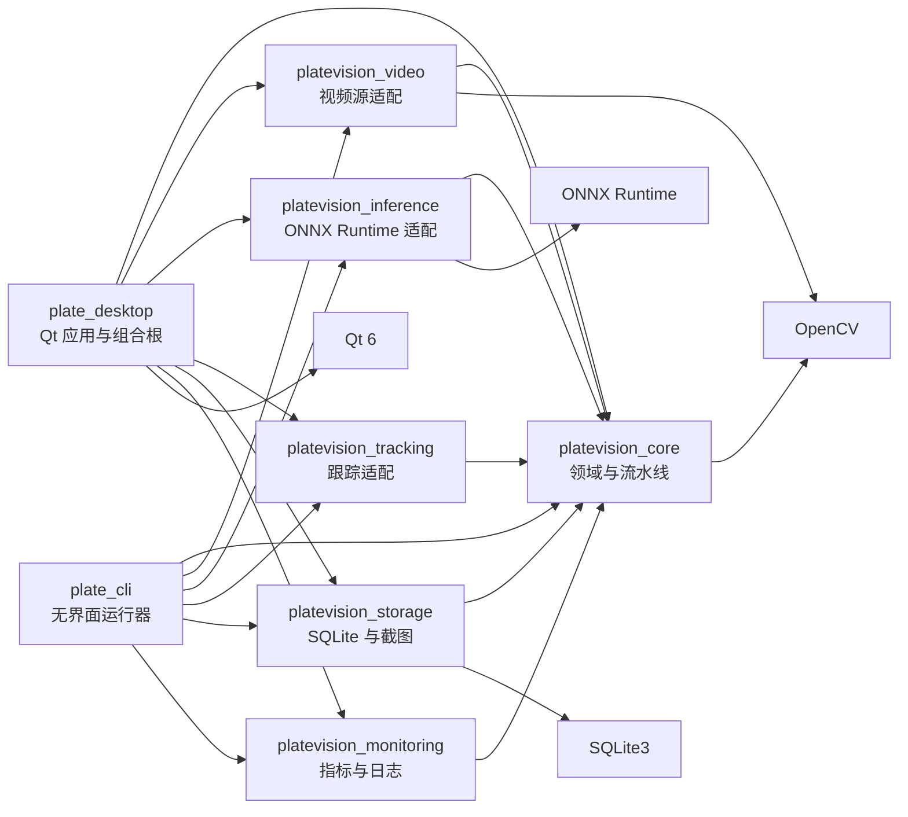
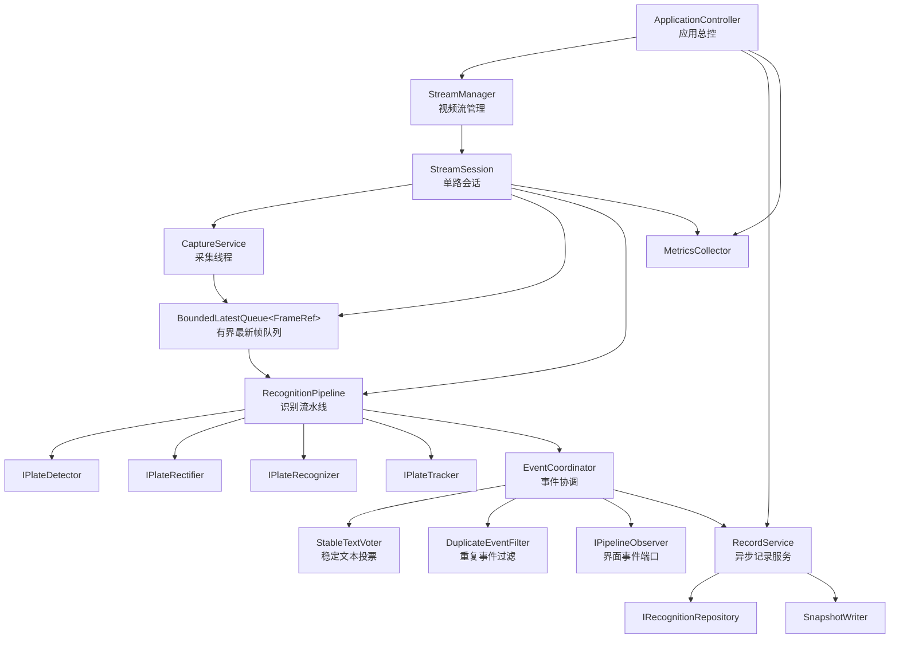
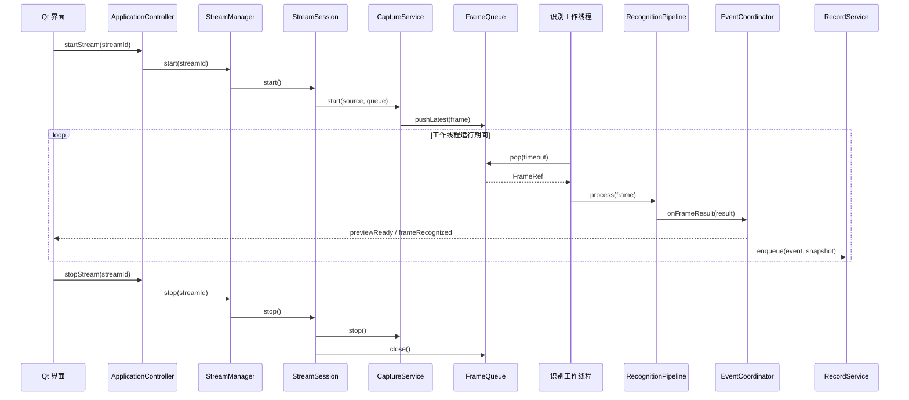
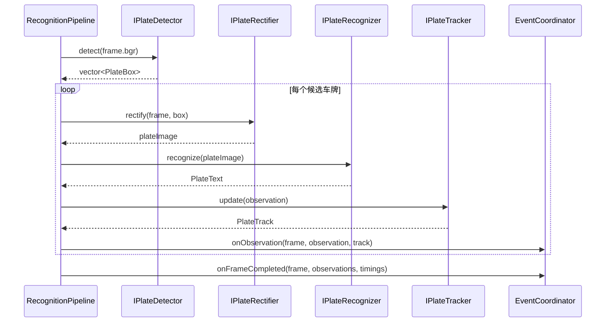
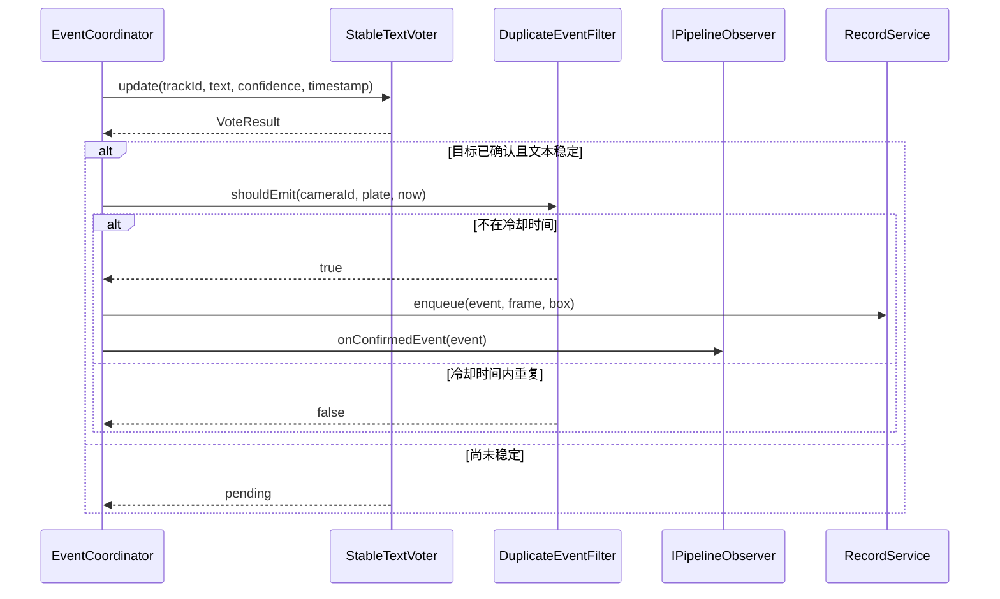

# 模块划分与核心类设计

状态：Phase 0 详细设计稿

关联文档：[整体架构设计](ARCHITECTURE.md)

## 1. 设计目标

本设计将整体架构拆解为可以独立开发、测试和替换的模块，并明确：

- 模块边界与静态依赖方向；
- 运行时对象之间的调用关系；
- 采集、推理、事件判定和存储的线程归属；
- 核心类的职责、接口、关键字段和生命周期；
- M1 无界面版本的最小实现范围；
- M2、M3 接入 Qt 界面和持久化时的扩展点。

## 2. 总体分层

系统采用“核心领域层 + 端口接口 + 适配器 + 组合根”的结构。

```text
应用层
  plate_desktop        Qt 界面、Qt 事件桥接
  plate_cli            无界面运行器、基准测试

核心层
  core/domain          帧、车牌、跟踪、事件、配置
  core/pipeline        采集服务、识别流水线、事件协调
  core/ports           视频源、检测、识别、跟踪、仓储接口

适配器层
  video                OpenCV 图片/视频、RTSP、摄像头
  inference            ONNX Runtime 检测器、识别器、透视矫正
  tracking             IOU 跟踪器
  storage              SQLite 仓储、截图写入

基础设施
  monitoring           指标采集、结构化日志
  config               JSON 配置和模型清单
```

依赖方向固定为：

```text
应用层 -> 核心层 <- 适配器层
```

`core` 不把 Qt、ONNX Runtime 或 SQLite 的头文件暴露给上层。具体实现由 `plate_desktop` 或 `plate_cli` 在启动时构造并注入。

## 3. 模块划分

| 模块 | CMake Target | 职责 | 不允许承担的工作 |
| --- | --- | --- | --- |
| 域名与配置 | `platevision_core` | 领域数据、配置结构、错误模型、流水线接口 | 创建窗口、加载 ONNX、访问数据库 |
| 识别流水线 | `platevision_core` | 检测到事件的核心流程编排、事件判定 | 依赖 Qt 信号槽或 SQLite API |
| 视频适配 | `platevision_video` | 图片、本地视频、RTSP、摄像头读取 | 车牌检测、数据库写入 |
| 推理适配 | `platevision_inference` | ONNX Runtime 模型加载、预处理、后处理 | UI 展示和记录查询 |
| 跟踪适配 | `platevision_tracking` | 目标关联、跟踪状态维护 | 车牌字符投票和数据库写入 |
| 存储适配 | `platevision_storage` | SQLite 迁移、事件写入、查询、截图保存 | 模型推理和界面布局 |
| Qt 桌面端 | `platevision_desktop` | 启动装配、界面展示、用户操作、线程桥接 | 承载核心业务规则 |
| 命令行端 | `platevision_cli` | 无界面运行、模型验证、性能基准 | 依赖 Qt GUI |
| 模型工具 | Python tools | 训练、ONNX 导出、离线精度评估 | 参与桌面应用运行时 |

## 4. 静态模块依赖



构建层约束：

- `platevision_core` 可以被任意端复用。
- `platevision_desktop` 和 `platevision_cli` 是唯一允许同时依赖所有适配器的目标。
- 适配器之间不互相直接调用。例如 `inference` 不直接调用 `storage`。
- 跨模块协作通过 `core` 中定义的接口和事件对象完成。

## 5. 运行时对象关系



调用关系原则：

- `ApplicationController` 只负责应用级命令，不处理每帧数据。
- `StreamManager` 管理会话生命周期，不知道检测模型细节。
- `StreamSession` 负责单路视频的线程和队列装配。
- `RecognitionPipeline` 只处理一帧，不自行创建线程。
- `EventCoordinator` 只在识别结果稳定后触发生成记录。
- `RecordService` 异步写入，不阻塞识别线程。
- `IPipelineObserver` 把核心事件转换为 Qt 信号，Qt 对象不进入核心库。

## 6. 启动调用链



## 7. 单帧处理调用链



`RecognitionPipeline` 不直接调用数据库、不直接发出 Qt 信号，也不决定界面刷新频率。

## 8. 事件判定调用链



## 9. 线程与所有权

| 对象 | 创建者 | 所有者 | 所在线程 | 说明 |
| --- | --- | --- | --- | --- |
| `ApplicationController` | 应用组合根 | 应用根对象 | UI/控制线程 | 只接受控制命令 |
| `StreamManager` | `ApplicationController` | `ApplicationController` | UI/控制线程 | 内部互斥保护会话表 |
| `StreamSession` | `StreamManager` | `StreamManager` | 创建于控制线程 | 启动后拥有采集和识别线程 |
| `CaptureService` | `StreamSession` | `StreamSession` | 独立采集线程 | 只负责读取和入队 |
| `BoundedLatestQueue` | `StreamSession` | `StreamSession` | 跨线程 | 内部使用互斥量和条件变量 |
| `RecognitionPipeline` | `StreamSession` | `StreamSession` | 识别工作线程 | 单次只处理一帧 |
| 检测/识别适配器 | `StreamSession` | `StreamSession` | 识别工作线程 | 首版不跨线程共享内部缓冲 |
| `EventCoordinator` | `StreamSession` | `StreamSession` | 识别工作线程 | 线程内状态不需要额外加锁 |
| `RecordService` | `ApplicationController` | `ApplicationController` | 独立存储线程 | 串行写数据库 |
| Qt 观察者 | 桌面应用组合根 | Qt 对象树 | UI 线程 | 通过队列信号接收数据 |

模型文件由进程级 `ModelRegistry` 管理，模型 Session 和输入输出缓冲由每路会话的推理上下文持有。首版单路视频不涉及共享 Session 的并发问题，后续多路扩展时再引入 Session 池。

## 10. 退出顺序

退出顺序必须固定，避免线程仍在使用对象时发生析构：

1. `ApplicationController::stop()` 停止接收新的启动命令。
2. `StreamManager::stopAll()` 依次停止所有会话。
3. 每个 `StreamSession` 先停止 `CaptureService`。
4. 关闭帧队列，唤醒阻塞中的识别线程。
5. 等待识别线程退出并清空尚未处理的事件。
6. `RecordService::flushAndStop()` 处理完已入队的记录。
7. 关闭 SQLite 连接和截图文件。
8. 停止指标采集并写出最终运行摘要。

任何线程都不得在析构函数中无限等待。阻塞读取和条件变量等待必须支持超时或取消信号。

## 11. 核心领域对象定义

```cpp
namespace platevision {

using FrameRef = std::shared_ptr<const Frame>;

struct PlateCandidate {
    PlateBox box;
    cv::Mat rectified_image;
    PlateText text;
};

struct StageTimings {
    std::chrono::microseconds detect{0};
    std::chrono::microseconds rectify{0};
    std::chrono::microseconds recognize{0};
    std::chrono::microseconds track{0};
    std::chrono::microseconds total{0};
};

struct FrameResult {
    FrameRef frame;
    std::vector<PlateObservation> observations;
    std::vector<PlateTrack> tracks;
    StageTimings timings;
};

struct RecordQuery {
    std::optional<std::uint64_t> camera_id;
    std::optional<std::string> plate_number;
    std::int64_t begin_ms{0};
    std::int64_t end_ms{0};
    int limit{200};
    int offset{0};
};

struct MetricsSnapshot {
    double capture_fps{0.0};
    double process_fps{0.0};
    std::uint64_t dropped_frames{0};
    double p50_latency_ms{0.0};
    double p95_latency_ms{0.0};
    std::uint64_t confirmed_events{0};
    std::size_t memory_bytes{0};
};

}  // namespace platevision
```

## 12. 核心接口定义

```cpp
namespace platevision {

class IPipelineObserver {
public:
    virtual ~IPipelineObserver() = default;

    virtual void onPreview(
        std::uint64_t stream_id,
        FrameRef frame,
        const std::vector<PlateObservation>& observations) = 0;

    virtual void onFrameResult(const FrameResult& result) = 0;

    virtual void onConfirmedEvent(const RecognitionEvent& event) = 0;

    virtual void onMetrics(const MetricsSnapshot& snapshot) = 0;

    virtual void onError(
        std::uint64_t stream_id,
        const std::string& code,
        const std::string& message) = 0;
};

class IInferenceFactory {
public:
    virtual ~IInferenceFactory() = default;

    virtual std::unique_ptr<IPlateDetector> createDetector(
        std::string& error) = 0;

    virtual std::unique_ptr<IPlateRectifier> createRectifier(
        std::string& error) = 0;

    virtual std::unique_ptr<IPlateRecognizer> createRecognizer(
        std::string& error) = 0;
};

class IVideoSourceFactory {
public:
    virtual ~IVideoSourceFactory() = default;

    virtual std::unique_ptr<IVideoSource> create(
        const StreamConfig& config,
        std::string& error) = 0;
};

}  // namespace platevision
```

`IPipelineObserver` 是核心层向界面输出事件的唯一通道。命令行端可以实现一个写 JSON 的观察者，Qt 端实现一个派发队列信号的观察者，两者共用同一套流水线。

## 13. 核心类定义

以下定义用于指导接口和头文件设计，不要求第一版一次性实现全部可选方法。

### 13.1 ConfigManager

```cpp
class ConfigManager final {
public:
    explicit ConfigManager(std::filesystem::path config_path);

    bool load(AppConfig& config, std::string& error) const;
    bool validate(const AppConfig& config, std::string& error) const;
    const std::filesystem::path& path() const noexcept;

private:
    std::filesystem::path config_path_;
};
```

职责：

- 解析 JSON 配置；
- 校验路径、队列容量、模型输入尺寸和 Provider；
- 把相对路径解析为相对于工程根目录或可执行文件目录的绝对路径；
- 不负责创建模型、线程或数据库连接。

### 13.2 ApplicationController

```cpp
class ApplicationController final {
public:
    ApplicationController(
        AppConfig config,
        std::unique_ptr<IVideoSourceFactory> video_factory,
        std::unique_ptr<IInferenceFactory> inference_factory,
        std::unique_ptr<IRecognitionRepository> repository,
        std::unique_ptr<SnapshotWriter> snapshot_writer,
        std::shared_ptr<IPipelineObserver> observer,
        std::shared_ptr<MetricsCollector> metrics);

    ~ApplicationController();

    bool initialize(std::string& error);
    void shutdown();

    bool startStream(std::uint64_t stream_id, std::string& error);
    void stopStream(std::uint64_t stream_id);
    void stopAllStreams();

    std::vector<StreamSnapshot> streamSnapshots() const;
    std::vector<RecognitionEvent> queryRecords(
        const RecordQuery& query,
        std::string& error) const;
    bool exportCsv(
        const RecordQuery& query,
        const std::filesystem::path& output,
        std::string& error) const;
    MetricsSnapshot metrics() const;

private:
    AppConfig config_;
    std::unique_ptr<StreamManager> stream_manager_;
    std::unique_ptr<RecordService> record_service_;
    std::shared_ptr<MetricsCollector> metrics_;
    bool initialized_{false};
};
```

职责：

- 作为应用组合根，装配所有具体实现；
- 暴露启动、停止、查询和导出命令；
- 持有应用级服务；
- 不处理帧和车牌识别细节。

### 13.3 StreamManager

```cpp
class StreamManager final {
public:
    StreamManager(
        IVideoSourceFactory& video_factory,
        IInferenceFactory& inference_factory,
        EventCoordinatorFactory event_factory,
        std::shared_ptr<MetricsCollector> metrics);

    bool addStream(const StreamConfig& config, std::string& error);
    bool startStream(std::uint64_t stream_id, std::string& error);
    void stopStream(std::uint64_t stream_id);
    void stopAll();

    std::vector<StreamSnapshot> snapshots() const;

private:
    IVideoSourceFactory& video_factory_;
    IInferenceFactory& inference_factory_;
    EventCoordinatorFactory event_factory_;
    std::shared_ptr<MetricsCollector> metrics_;
    mutable std::mutex mutex_;
    std::unordered_map<std::uint64_t, std::unique_ptr<StreamSession>> sessions_;
};
```

职责：

- 维护视频流 ID 到 `StreamSession` 的映射；
- 管理单路会话的创建、启动和停止；
- 保证重复启动、非法 ID 和重复停止有明确结果；
- 只提供线程安全的控制面接口。

### 13.4 StreamSession

```cpp
struct StreamDependencies {
    IVideoSourceFactory& video_factory;
    IInferenceFactory& inference_factory;
    EventCoordinatorFactory& event_factory;
    std::shared_ptr<MetricsCollector> metrics;
};

class StreamSession final {
public:
    StreamSession(StreamConfig config, StreamDependencies dependencies);
    ~StreamSession();

    bool start(std::string& error);
    void stop();
    StreamSnapshot snapshot() const;

private:
    void recognitionLoop();

    StreamConfig config_;
    StreamDependencies dependencies_;
    std::unique_ptr<IVideoSource> source_;
    BoundedLatestQueue<FrameRef> frame_queue_;
    CaptureService capture_service_;
    std::unique_ptr<RecognitionPipeline> pipeline_;
    std::thread recognition_thread_;
    std::atomic<bool> running_{false};
};
```

职责：

- 创建视频源、推理适配器、跟踪器和事件协调器；
- 启动采集线程和识别线程；
- 维护单路会话状态；
- 在停止时按固定顺序关闭队列和线程。

`StreamSession` 不向外部暴露检测器和识别器，也不允许 UI 直接调用 `RecognitionPipeline`。

### 13.5 有界队列

```cpp
template <typename T>
class BoundedLatestQueue final {
public:
    explicit BoundedLatestQueue(std::size_t capacity);

    bool pushLatest(T value);
    bool pop(T& value, std::chrono::milliseconds timeout);
    void close();
    bool closed() const noexcept;
    std::uint64_t droppedCount() const noexcept;

private:
    std::size_t capacity_;
    std::deque<T> items_;
    mutable std::mutex mutex_;
    std::condition_variable condition_;
    bool closed_{false};
    std::uint64_t dropped_{0};
};
```

`BoundedLatestQueue` 用于采集到识别的路径。行为如下：

- 队列满时删除最旧元素并写入新元素；
- `close()` 唤醒所有等待者；
- 关闭后 `pop()` 返回剩余元素，队列为空时返回 `false`；
- 所有状态由同一把互斥量保护。

存储事件不能使用“丢弃最旧元素”的策略，因此单独定义 `BoundedBlockingQueue`：

```cpp
template <typename T>
class BoundedBlockingQueue final {
public:
    explicit BoundedBlockingQueue(std::size_t capacity);

    bool push(T value, std::chrono::milliseconds timeout);
    bool pop(T& value, std::chrono::milliseconds timeout);
    void close();
    bool closed() const noexcept;

private:
    std::size_t capacity_;
    std::deque<T> items_;
    mutable std::mutex mutex_;
    std::condition_variable not_empty_;
    std::condition_variable not_full_;
    bool closed_{false};
};
```

`BoundedBlockingQueue` 的队列满时，生产者等待 `not_full_` 条件变量；等待超时或队列关闭时返回 `false`。`RecordService` 对失败的任务记录错误指标，不能静默丢弃。

### 13.6 CaptureService

```cpp
class CaptureService final {
public:
    CaptureService(
        IVideoSource& source,
        BoundedLatestQueue<FrameRef>& queue,
        std::shared_ptr<MetricsCollector> metrics);

    bool start(std::string& error);
    void stop();
    bool running() const noexcept;

private:
    void captureLoop();

    IVideoSource& source_;
    BoundedLatestQueue<FrameRef>& queue_;
    std::shared_ptr<MetricsCollector> metrics_;
    std::thread thread_;
    std::atomic<bool> running_{false};
    std::uint64_t next_sequence_{0};
};
```

职责：

- 独立读取视频源；
- 补充帧序号、接收时间和源时间戳；
- 把帧封装成 `FrameRef` 后写入有界队列；
- 统计采集 FPS、读取失败和丢帧；
- 不执行任何模型推理。

### 13.7 RecognitionPipeline

```cpp
struct PipelineDependencies {
    IPlateDetector& detector;
    IPlateRectifier& rectifier;
    IPlateRecognizer& recognizer;
    IPlateTracker& tracker;
    EventCoordinator& event_coordinator;
    std::shared_ptr<MetricsCollector> metrics;
};

class RecognitionPipeline final {
public:
    explicit RecognitionPipeline(PipelineDependencies dependencies);

    FrameResult process(FrameRef frame);
    void reset();

private:
    std::vector<PlateCandidate> detectAndRecognize(const Frame& frame);
    PlateObservation buildObservation(
        const Frame& frame,
        const PlateCandidate& candidate);

    PipelineDependencies dependencies_;
};
```

职责：

- 组织检测、矫正、识别和跟踪；
- 计算各阶段耗时；
- 把单帧结果提交给 `EventCoordinator`；
- 保持无界面、无线程、无数据库依赖。

### 13.8 EventCoordinator

```cpp
class EventCoordinator final {
public:
    EventCoordinator(
        StreamConfig stream,
        std::shared_ptr<IPipelineObserver> observer,
        std::shared_ptr<RecordService> record_service,
        std::shared_ptr<MetricsCollector> metrics);

    void onObservation(
        FrameRef frame,
        const PlateObservation& observation,
        const PlateTrack& track);

    void onFrameCompleted(const FrameResult& result);
    void onPipelineError(const std::string& code, const std::string& message);

private:
    StreamConfig stream_;
    std::shared_ptr<IPipelineObserver> observer_;
    std::shared_ptr<RecordService> record_service_;
    std::shared_ptr<MetricsCollector> metrics_;
    StableTextVoter voter_;
    DuplicateEventFilter duplicate_filter_;
};
```

职责：

- 维护稳定文本投票和重复事件过滤；
- 只在目标确认且文本稳定时生成 `RecognitionEvent`；
- 向 UI 发布预览和结果；
- 向 `RecordService` 提交异步落库任务。

### 13.9 StableTextVoter

```cpp
struct VoteResult {
    bool stable{false};
    std::string text;
    PlateColor color{PlateColor::Unknown};
    float confidence{0.0f};
    int hit_count{0};
};

class StableTextVoter final {
public:
    VoteResult update(
        std::uint64_t track_id,
        std::string text,
        PlateColor color,
        float confidence,
        std::int64_t timestamp_us);

    void removeExpired(std::int64_t now_us, std::int64_t ttl_us);
    void reset();

private:
    std::size_t window_size_{5};
    int stable_hits_{3};
    std::unordered_map<std::uint64_t, TrackVoteState> states_;
};
```

`TrackVoteState` 保存最近若干次文本、置信度、颜色和时间戳，最终文本按置信度加权投票产生。

### 13.10 DuplicateEventFilter

```cpp
class DuplicateEventFilter final {
public:
    explicit DuplicateEventFilter(
        std::chrono::milliseconds cooldown,
        std::size_t max_entries);

    bool shouldEmit(
        std::uint64_t camera_id,
        const std::string& normalized_plate,
        std::int64_t now_us);

    void clearExpired(std::int64_t now_us);

private:
    std::chrono::milliseconds cooldown_;
    std::size_t max_entries_;
    std::unordered_map<PlateKey, std::int64_t> last_emitted_;
};
```

车牌归一化会去掉空格和分隔符，并纠正易混淆字符。过滤键为 `(camera_id, normalized_plate)`。

### 13.11 RecordService

```cpp
struct RecordTask {
    RecognitionEvent event;
    cv::Mat snapshot;
    PlateBox plate_box;
};

class RecordService final {
public:
    RecordService(
        std::unique_ptr<IRecognitionRepository> repository,
        std::unique_ptr<SnapshotWriter> snapshot_writer,
        std::shared_ptr<IPipelineObserver> observer,
        std::shared_ptr<MetricsCollector> metrics);

    ~RecordService();

    bool start(std::string& error);
    bool enqueue(RecordTask task);
    void flushAndStop();

    std::vector<RecognitionEvent> query(
        const RecordQuery& query,
        std::string& error) const;

    bool exportCsv(
        const RecordQuery& query,
        const std::filesystem::path& output,
        std::string& error) const;

private:
    void writerLoop();

    std::unique_ptr<IRecognitionRepository> repository_;
    std::unique_ptr<SnapshotWriter> snapshot_writer_;
    std::shared_ptr<IPipelineObserver> observer_;
    std::shared_ptr<MetricsCollector> metrics_;
    BoundedBlockingQueue<RecordTask> task_queue_;
    std::thread writer_thread_;
    std::atomic<bool> running_{false};
};
```

职责：

- 在独立线程中串行写数据库；
- 先写截图，再写数据库记录；
- 数据库失败时通过观察者发出错误事件；
- 退出时处理完已入队任务。

### 13.12 SnapshotWriter

```cpp
class SnapshotWriter final {
public:
    explicit SnapshotWriter(std::filesystem::path root_directory);

    bool write(
        std::uint64_t stream_id,
        std::int64_t captured_at_us,
        const std::string& plate_number,
        const cv::Mat& image,
        std::filesystem::path& relative_path,
        std::string& error) const;

private:
    std::filesystem::path root_directory_;
};
```

写入步骤：

1. 根据日期和摄像头创建目录；
2. 生成不包含非法字符的文件名；
3. 写入临时文件；
4. 刷新文件；
5. 原子重命名为最终 JPEG；
6. 返回相对于数据根目录的路径。

### 13.13 MetricsCollector

```cpp
class MetricsCollector final {
public:
    void observeStage(
        std::uint64_t stream_id,
        PipelineStage stage,
        std::chrono::microseconds duration);

    void increment(
        std::uint64_t stream_id,
        std::string_view counter,
        std::uint64_t delta = 1);

    void setGauge(
        std::uint64_t stream_id,
        std::string_view gauge,
        double value);

    MetricsSnapshot snapshot(std::uint64_t stream_id) const;
    void reset(std::uint64_t stream_id);

private:
    mutable std::mutex mutex_;
    std::unordered_map<std::uint64_t, StreamMetrics> streams_;
};
```

延迟统计使用固定窗口或环形缓冲保留最近 N 次采样，避免长期运行时无限增长。

## 14. 适配器类定义

适配器只实现端口接口，不参与应用控制。

```cpp
class OpenCvVideoSource final : public IVideoSource {
public:
    bool open(const SourceConfig& config, std::string& error) override;
    bool read(Frame& frame, std::chrono::milliseconds timeout) override;
    void close() override;

private:
    cv::VideoCapture capture_;
    SourceConfig config_;
};

class OnnxPlateDetector final : public IPlateDetector {
public:
    explicit OnnxPlateDetector(std::shared_ptr<ModelResources> resources);

    std::vector<PlateBox> detect(
        const cv::Mat& frame,
        std::string& error) override;

private:
    std::shared_ptr<ModelResources> resources_;
    DetectionPreprocessor preprocessor_;
    DetectionPostprocessor postprocessor_;
};

class PerspectiveRectifier final : public IPlateRectifier {
public:
    explicit PerspectiveRectifier(cv::Size output_size);

    cv::Mat rectify(
        const cv::Mat& frame,
        const PlateBox& box) override;

private:
    cv::Size output_size_;
};

class OnnxPlateRecognizer final : public IPlateRecognizer {
public:
    explicit OnnxPlateRecognizer(
        std::shared_ptr<ModelResources> resources);

    PlateText recognize(
        const cv::Mat& plate_image,
        std::string& error) override;

private:
    std::shared_ptr<ModelResources> resources_;
    RecognitionPreprocessor preprocessor_;
    CtcDecoder decoder_;
};

class IouPlateTracker final : public IPlateTracker {
public:
    explicit IouPlateTracker(TrackerConfig config);

    PlateTrack update(
        const PlateObservation& observation) override;
    void reset() override;

private:
    TrackerConfig config_;
    std::uint64_t next_track_id_{1};
    std::vector<TrackState> tracks_;
};

class SqliteRecognitionRepository final
    : public IRecognitionRepository {
public:
    explicit SqliteRecognitionRepository(
        std::filesystem::path database_path);

    bool initialize(std::string& error);
    bool save(
        const RecognitionEvent& event,
        std::string& error) override;
    std::vector<RecognitionEvent> query(
        const RecordQuery& query) override;

private:
    std::filesystem::path database_path_;
    sqlite3* database_{nullptr};
};
```

模型适配器内部持有的输入输出张量缓冲只能在所属识别线程使用。多路视频扩展时，不允许不同线程共享同一组预分配缓冲。

## 15. Qt 事件桥接

Qt 需要通过一个只属于桌面端的桥接类连接核心观察者：

```cpp
class QtPipelineObserver final : public QObject,
                                 public IPipelineObserver {
    Q_OBJECT

public:
    void onPreview(
        std::uint64_t stream_id,
        FrameRef frame,
        const std::vector<PlateObservation>& observations) override;

    void onFrameResult(const FrameResult& result) override;
    void onConfirmedEvent(const RecognitionEvent& event) override;
    void onMetrics(const MetricsSnapshot& snapshot) override;
    void onError(
        std::uint64_t stream_id,
        const std::string& code,
        const std::string& message) override;

signals:
    void previewReady(
        std::uint64_t streamId,
        QImage image,
        QList<PlateOverlay> overlays);
    void recordRecognized(const RecognitionEvent& event);
    void metricsUpdated(const MetricsSnapshot& snapshot);
    void pipelineError(
        std::uint64_t streamId,
        const QString& code,
        const QString& message);
};
```

桥接规则：

- 回调可能来自识别线程，不能直接操作 QWidget；
- `QImage` 在桥接层从 `cv::Mat` 转换；
- 只传递缩放后的预览图，不把全分辨率原始帧长期保存在 Qt 对象中；
- 所有 UI 更新通过 queued signal 或 `QMetaObject::invokeMethod` 投递到主线程。

## 16. 工厂与组合根

桌面端启动流程：

```cpp
int runDesktop(const std::filesystem::path& config_path) {
    ConfigManager config_manager(config_path);
    AppConfig config;
    std::string error;

    if (!config_manager.load(config, error)) {
        return 1;
    }

    auto metrics = std::make_shared<MetricsCollector>();
    auto observer = std::make_shared<QtPipelineObserver>();
    auto video_factory = std::make_unique<OpenCvVideoSourceFactory>();
    auto inference_factory =
        std::make_unique<OnnxInferenceFactory>(config.models);
    auto repository = std::make_unique<SqliteRecognitionRepository>(
        config.storage.database_path);
    auto snapshot_writer = std::make_unique<SnapshotWriter>(
        config.storage.snapshot_directory);

    ApplicationController controller(
        config,
        std::move(video_factory),
        std::move(inference_factory),
        std::move(repository),
        std::move(snapshot_writer),
        observer,
        metrics);

    if (!controller.initialize(error)) {
        return 2;
    }

    return runQtEventLoop(controller, observer);
}
```

命令行端复用同一组工厂，只把 `IPipelineObserver` 替换为 JSON 输出实现。这样 CLI 和 Qt 端走的是同一条识别流水线。

## 17. 各阶段实现范围

### M1：无界面流水线

必须实现：

- `Frame`、`PlateBox`、`PlateText`、`PlateObservation`、`PlateTrack`；
- `BoundedLatestQueue`；
- `CaptureService`；
- `RecognitionPipeline`；
- 模拟检测器、模拟识别器；
- `OpenCvVideoSource`；
- `plate_cli`；
- 阶段耗时统计的最小版本。

可以暂缓：

- `StableTextVoter` 的真实多帧投票；
- SQLite 持久化；
- Qt 桥接；
- 多路视频和 GPU 优化。

### M2：Qt 桌面应用

新增：

- `QtPipelineObserver`；
- `MainWindow` 和结果模型；
- 启动、停止、视频源选择；
- 预览图转换与结果叠加。

### M3：跟踪与通行记录

新增：

- `StableTextVoter`；
- `DuplicateEventFilter`；
- `RecordService`；
- `SnapshotWriter`；
- `SqliteRecognitionRepository`；
- 查询与 CSV 导出。

### M4：性能与发布

增强：

- `MetricsCollector` 的 p50/p95 统计；
- 帧缓冲池；
- ONNX Runtime 并发配置；
- 长时间运行监控；
- 发布包和模型清单校验。

## 18. 设计约束汇总

- UI 线程不得执行模型推理、视频阻塞读取或 SQLite 写入。
- 核心层不得直接依赖 Qt、ONNX Runtime 或 SQLite。
- 识别线程不得直接操作 QWidget。
- 每路视频只允许一个识别工作线程修改自身的跟踪和投票状态。
- 单帧原始图像不进入数据库。
- 车牌记录必须经过跟踪和稳定文本判定。
- 数据库写入失败不能导致采集和识别线程崩溃。
- 停止过程中所有阻塞队列和线程必须可以在有界时间内退出。
- 模型、阈值和队列容量通过配置管理，不散落为魔法数字。
